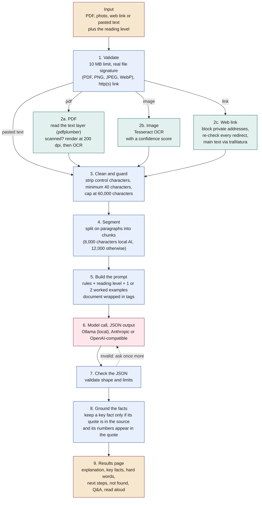
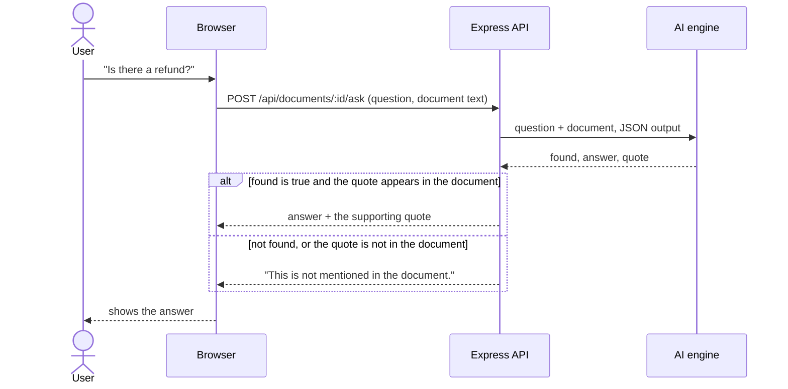
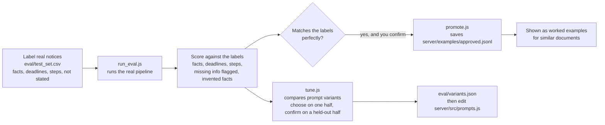

# Accessibility Translator

> **Turning complex information into understanding and action.**


Accessibility Translator is a web application that takes a **PDF, a photo of a document, a web page or pasted text** and gives back:

- a short explanation in plain language, at one of three reading levels,
- **key facts**, each backed by an exact quote from the original,
- hard words explained, and numbered **next steps**,
- a list of what the document **does not say** (instead of guessing),
- answers to follow-up questions, taken **only from the document**.

It is built for people who can open an official notice, bill or form but find it hard to understand: students, older readers, people with low digital literacy, and readers with dyslexia or low vision.

<p align="center">
  
  <br>
  <sub>The results page, shown here with the built-in demo engine (rule-based, not AI).</sub>
</p>

**Status:** prototype, built as an Independent Project (B.Tech CSE, Data Science). English only for now. See [Limitations and roadmap](#limitations-and-roadmap).

## Contents

[Features](#features) · [How it works](#how-it-works) · [Quick start](#quick-start) · [Configuration](#configuration) · [API](#api) · [Accessibility](#accessibility) · [Project structure](#project-structure) · [Testing and evaluation](#testing-and-evaluation) · [Security and privacy](#security-and-privacy) · [Limitations and roadmap](#limitations-and-roadmap) · [Troubleshooting](#troubleshooting) · [Author and license](#author-and-license)

## Features

- **Four ways in:** PDF (text or scanned), image or phone photo (OCR), public web link, or pasted text.
- **Three reading levels:** Very Simple, Simple, Standard.
- **Six result sections:** explanation, key facts, hard words, next steps, "not found in the document", and a question box.
- **Source-grounded:** a key fact is kept only if its quote really appears in the document. Missing information is reported as not found, never invented.
- **Free and private by default:** runs a local model through [Ollama](https://ollama.com) (`qwen3.5:4b`), so documents stay on your computer. Anthropic Claude or any OpenAI-compatible service can be used instead.
- **Demo mode:** `npm run demo` starts the whole site with no AI, no API key and no packages to install.
- **Reading comforts:** adjustable text size and line spacing, light and dark mode, high contrast, dyslexia-friendly font, reduced motion, read-aloud.
- **Defensive by design:** real file-type checks, a safe web fetcher that blocks internal addresses, and a prompt that treats the document as data, not instructions.

## How it works

### The processing pipeline



Colour key: tan is the browser, blue is the Node/Express API, green is the Python extractor, pink is the AI engine.

| # | Step | What happens | Code |
|---|------|--------------|------|
| 1 | **Validate** | Upload limited to 1 file, 10 MB. The file's first bytes are checked, not just its name. Links must start with `http://` or `https://`. | `server/src/routes/documents.js`, `server/src/services/files.js` |
| 2 | **Extract** | The Node API calls the Python extractor with a shared secret. **PDF:** text layer first (up to 40 pages); if there is almost no text it is treated as a scan, and up to 15 pages are rendered at 200 dpi and OCR'd. **Image:** downscaled to at most 4000 px, then OCR'd. **Link:** fetched safely (see [Security](#security-and-privacy)), main article text extracted. | `extractor/app.py`, `server/src/services/extract.js` |
| 3 | **Clean and guard** | Control characters and extra blank lines are removed. Under 40 characters is rejected as "not enough readable text". Over 60,000 is cut and flagged `TRUNCATED`. OCR confidence below 55 adds a `BLURRY` warning; scanned input adds `OCR_USED`. | `extract.js`, `routes/documents.js` |
| 4 | **Segment** | Long text is split on paragraph boundaries so each piece fits the model. | `server/src/services/llm.js` |
| 5 | **Prompt** | A strict system prompt: use only the document, treat it as data, put anything missing in `notFound`, keep numbers and dates exactly as written, write at the chosen level. One or two worked examples are added: your approved ones if similar enough, otherwise a built-in one. | `server/src/prompts.js`, `server/src/examples.js` |
| 6 | **Model call** | Sent to the chosen engine. With Ollama, the exact JSON shape is enforced by the runtime, "thinking" is switched off and temperature is 0. | `server/src/services/providers.js`, `schemas.js` |
| 7 | **Check the JSON** | The reply is parsed and validated (shape and size limits). If invalid, the model is told what was wrong and asked once more. A second failure gives a friendly error. Long documents are analysed part by part, each with a short summary of what came before, then merged by one final call. | `llm.js`, `server/src/services/validate.js` |
| 8 | **Ground the facts** | Each key fact must carry an exact `quote`. It is dropped unless the quote appears in the source (ignoring case and spacing) and every number in its value appears in that quote. Dropped facts are reported in `warnings`. | `validate.js` |
| 9 | **Respond** | One JSON object goes back to the page. If a signed-in user and a database are configured, it is also saved. | `routes/documents.js` |

**What the checks do and do not guarantee.** Key facts and question answers are verified against the source text. The explanation, hard-word meanings and next steps are written by the model and are **not** individually fact-checked, and the "not found" list is the model's judgement. The page therefore says: *"Please check the original for important decisions."*

### Grounded questions and answers



### The evaluation and learning loop

The model is **not** trained or fine-tuned. Quality is improved by measuring it on documents you have labelled, then changing the prompt or the worked examples.



## Quick start

You need **Node.js 18 or newer**. Commands below are for Windows PowerShell; macOS and Linux differ only where noted.

```bash
git clone https://github.com/<your-username>/accessibility-translator.git
cd accessibility-translator
```

### Option A: demo mode (30 seconds, no AI)

```bash
npm run demo
```

Open <http://localhost:4000>, choose **Workspace**, open the **Text** tab, paste a notice and press **Simplify**. This uses a simple rule-based engine, reads pasted text only, and still quotes every key fact from your text.

### Option B: full app with a free local AI

1. Install [Ollama](https://ollama.com) and start it.
2. Download the model (about 3.3 GB). `qwen3.5:4b` is the default and suits a laptop GPU with about 6 GB of memory. Ollama can also run on a CPU, only more slowly.

   ```bash
   ollama pull qwen3.5:4b
   ```

3. Install the website packages and create your settings file:

   ```powershell
   npm run setup
   copy server\.env.example server\.env        # macOS / Linux: cp server/.env.example server/.env
   ```

   The example file is already set to Ollama, so there is nothing to edit and no API key to add.

4. Check that everything works. This runs the real pipeline once and reports speed and GPU use:

   ```bash
   npm run ollama:check
   ```

5. Start the site and open <http://localhost:4000>:

   ```bash
   npm start
   ```

   Leave this terminal open. Closing it stops the site. In VS Code you can press **F5** and choose "Run website + API" instead.

If `npm run doctor` or the server start-up prints a warning, it names the exact fix.

### Optional: PDF, photo and web-link support

Text paste works without this. For files and links, also run the Python extractor in a **second terminal**.

1. Install **Python 3.10+**, **Tesseract OCR** and **Poppler**.
   Windows: the UB Mannheim Tesseract installer and a Poppler build (add its `bin` folder to `PATH`).
   macOS: `brew install tesseract poppler`. Ubuntu: `sudo apt install tesseract-ocr poppler-utils`.
2. Create a virtual environment and install the packages:

   ```powershell
   python -m venv .venv
   .venv\Scripts\activate                      # macOS / Linux: source .venv/bin/activate
   python -m pip install -r extractor/requirements.txt
   ```

3. Start the extractor. `INTERNAL_KEY` **must equal** the value in `server/.env`, because `npm run extractor` does not read that file:

   ```powershell
   $env:INTERNAL_KEY = "change-me-long-random"      # macOS / Linux: export INTERNAL_KEY=change-me-long-random
   npm run extractor
   ```

   Pressing **F5** and choosing "Run Python extractor" in VS Code loads `server/.env` for you.

### Other AI engines

Set `LLM_PROVIDER` in `server/.env` (examples are in `server/.env.example`):

| Engine | `LLM_PROVIDER` | You also set |
|---|---|---|
| Ollama (default) | `ollama` | `OLLAMA_MODEL`, optionally `OLLAMA_NUM_CTX` |
| Anthropic Claude | `anthropic` | `ANTHROPIC_API_KEY`, `MODEL` |
| Any OpenAI-compatible service (for example Google Gemini's free tier) | `openai` | `LLM_BASE_URL`, `LLM_API_KEY`, `LLM_MODEL` |

If `LLM_PROVIDER` is not set, the app uses Anthropic when `ANTHROPIC_API_KEY` looks like a real key, and Ollama otherwise.

## Configuration

All settings live in `server/.env`. Defaults come from `server/src/config.js`.

| Variable | Default | Meaning |
|---|---|---|
| `PORT` | `4000` | Port for the website and API |
| `LLM_PROVIDER` | `ollama`, or `anthropic` if a real key is set | `ollama`, `anthropic` or `openai` |
| `OLLAMA_MODEL` | `qwen3.5:4b` | Local model name |
| `OLLAMA_NUM_CTX` | `16384` | How much text the model sees at once. Lower to `8192` if part of the model runs on the CPU |
| `OLLAMA_URL` | `http://127.0.0.1:11434` | Where Ollama is running |
| `OLLAMA_KEEP_ALIVE` | `30m` | How long the model stays loaded between requests |
| `OLLAMA_TIMEOUT_MS` | `240000` | Give up on one model call after this long |
| `ANTHROPIC_API_KEY`, `MODEL` | none, `claude-sonnet-5-5` | Anthropic engine. The key stays on the server |
| `LLM_BASE_URL`, `LLM_API_KEY`, `LLM_MODEL` | none | OpenAI-compatible engine |
| `CHUNK_CHARS` | `8000` (Ollama), `12000` (others) | Size of each piece of a long document |
| `EXTRACTOR_URL` | `http://127.0.0.1:8001` | Where the Python extractor is running |
| `INTERNAL_KEY` | `change-me` | Shared secret between the API and the extractor. Set the same long random value in both |
| `OCR_LANGS` | `eng` | Tesseract languages, joined with `+` |
| `MONGO_URI` | empty | Optional MongoDB. Leave empty to run without a database |
| `EXAMPLES_FILE` | `server/examples/approved.jsonl` | Where approved worked examples are read from |

## API

The site and API share one port. Errors always look like `{ "message": "...", "code": "..." }` with a plain-language message.

| Method and path | Purpose |
|---|---|
| `POST /api/documents/process` | Simplify a document (multipart form) |
| `POST /api/documents/:id/ask` | Ask a question about a document (JSON) |
| `GET`, `DELETE /api/documents` | A signed-in user's library |
| `GET`, `POST`, `DELETE /api/results/saved` | A signed-in user's saved results |

The last two rows need a real login. The development server uses a stub that answers `401`; see [Limitations](#limitations-and-roadmap).

**Simplify** (examples use bash; in PowerShell call `curl.exe`):

```bash
curl -X POST http://localhost:4000/api/documents/process \
  -F source=txt -F level=Simple -F language=English \
  -F "text=NOTICE. Applicants shall remit the prescribed fee of Rs. 500 on or before 30 November 2026 through the student portal, failing which the application stands rejected. A receipt shall be retained by the applicant."
```

Form fields: `source` is `pdf`, `img`, `url` or `txt`; `level` is `Very Simple`, `Simple` or `Standard`; `language` is `English`; plus `file`, `url` or `text` to match `source`. An abridged response:

```json
{
  "id": "g1700000000000",
  "level": "Simple",
  "language": "English",
  "title": "Application fee notice",
  "explanation": [
    "You must pay a fee of Rs. 500 before 30 November 2026. You pay on the student portal.",
    "If you do not pay in time, your application is rejected."
  ],
  "keyFacts": [
    { "label": "Fee", "value": "Rs. 500", "quote": "prescribed fee of Rs. 500" },
    { "label": "Deadline", "value": "30 November 2026", "quote": "on or before 30 November 2026" }
  ],
  "difficultTerms": [{ "term": "remit", "meaning": "pay" }],
  "actionSteps": ["Pay Rs. 500 on the student portal before 30 November 2026.", "Keep your receipt."],
  "notFound": ["Refund rules", "Late-fee amount", "Helpline number"],
  "warnings": [],
  "original": "NOTICE. Applicants shall remit the prescribed fee of Rs. 500 ..."
}
```

**Ask a question:**

```bash
curl -X POST http://localhost:4000/api/documents/any/ask \
  -H "Content-Type: application/json" \
  -d '{"question": "Is there a refund?", "text": "NOTICE. Applicants shall remit the prescribed fee of Rs. 500 on or before 30 November 2026 through the student portal, failing which the application stands rejected."}'
# -> { "found": false, "answer": "This is not mentioned in the document.", "quote": "" }
```

**Warnings** in `warnings`: `BLURRY` (low OCR confidence), `OCR_USED`, `TRUNCATED` (document cut at 60,000 characters), `DEMO_ENGINE`, and `Dropped ungrounded fact: <label>`.

**Embedding.** `documentsRouter({ auth, Doc })` and `resultsRouter({ auth, Doc })` can be mounted in an existing Express app with your own login middleware and Mongoose model. See [`docs/BACKEND.md`](docs/BACKEND.md).

## Accessibility

Reading settings are on the **Settings** page and are remembered in the browser.

| Feature | Detail |
|---|---|
| Text size | 90% to 150% |
| Line spacing | 1.4 to 2.2 |
| Reading mode | Light or dark (follows the system dark setting on first visit) |
| High contrast | Stronger text and borders, in both light and dark |
| Dyslexia-friendly font | Lexend |
| Reduce motion | Off switch for animations; also follows the system setting |
| Read aloud | Browser speech synthesis with pause, resume and speed |
| Page structure | Skip-to-content link and live-region announcements for progress and results |
| Plain-language errors | Every error message is written for a non-technical reader |

No formal accessibility audit or screen-reader test has been run yet.

## Project structure

```text
accessibility-translator/
├── frontend/
│   └── index.html              the whole website (HTML, CSS and JS in one file, no build step)
├── server/                     Node / Express API (ES modules)
│   ├── src/
│   │   ├── index.js            dev server: API + static site, stub login
│   │   ├── demo-server.js      zero-dependency demo server
│   │   ├── config.js           settings and defaults
│   │   ├── prompts.js          the prompts: tune these
│   │   ├── examples.js         approved worked examples
│   │   ├── routes/documents.js endpoints
│   │   ├── models/Document.js  optional MongoDB model
│   │   └── services/
│   │       ├── files.js        real file-type check
│   │       ├── extract.js      client for the Python extractor
│   │       ├── llm.js          chunking, retry, grounding, Q&A
│   │       ├── providers.js    Ollama and OpenAI-compatible engines
│   │       ├── schemas.js      JSON shapes forced on the local model
│   │       ├── validate.js     reply validation and fact grounding
│   │       └── offline.js      rule-based demo engine
│   ├── test/                   unit tests (no network, GPU or key needed)
│   └── .env.example            copy to .env
├── extractor/                  Python / FastAPI: PDF, OCR, safe web fetch
├── eval/                       labelled test sets, scorers, tuning and dataset runners
├── scripts/                    doctor.mjs (setup check), ollama-check.mjs
├── docs/                       BACKEND.md and images
└── .vscode/                    F5 launch configurations
```

## Testing and evaluation

### Unit tests

```bash
npm test
```

51 tests cover validation, fact grounding, chunking and merging, question answering, the demo engine, the Ollama connection (against a fake Ollama), the scoring code and the dataset runners. They run with a fake model, so they need no key, network or GPU.

### Scoring the AI on your own documents

Label documents in `eval/test_set.csv`: the true key facts, deadlines, steps, and what the document does **not** say (separate items with `;`). Then, from the top folder:

```bash
node eval/run_eval.js eval/sample_notices_test_set.csv
```

It runs the real pipeline with the engine set in `server/.env` and reports, per document and in total:

| Metric | Meaning |
|---|---|
| Key facts, deadlines, steps found | Expected items that appear in the result |
| Missing info flagged | Items the document does not state that the app correctly listed as not found |
| Hallucinated facts | A "not in the document" item that showed up as a fact (should be 0) |
| Ungrounded facts dropped | Facts the grounding check removed |

`eval/sample_notices_test_set.csv` holds eight fictional notices (scholarship, electricity bill, admit card, KYC, court hearing, circular, hostel, property tax) plus two rows that read the same kind of notice from a PDF and a photo in `eval/files/`. Start the extractor first, or skip those two rows.

### Improving it from your own data

```bash
npm --prefix server run promote -- D002   # teach the app from a row it gets exactly right
npm --prefix server run tune              # compare prompt variants fairly
```

`promote` offers a document as a worked example only if the output matches your labels perfectly and nothing is invented, and asks you to confirm. `tune` compares the variants in `eval/variants.json`, choosing on half the rows and recommending a variant only if it is also not worse on the held-out half. `server/examples/approved.jsonl` contains your documents' text and is git-ignored.

### Public benchmarks (optional)

`eval/datasets/` and `eval/asset/` can run public sets (SQuAD v2, OneStopEnglish, FLORES-200, IN22, FUNSD, SROIE and ASSET) for question answering, reading level, translation, OCR and simplification. They are for **testing only**: several are non-commercial, so check each licence in [`eval/datasets/DATASETS.md`](eval/datasets/DATASETS.md) and never copy their text into the product.

**Results:** no benchmark numbers have been published for the AI engine yet. This section will be filled in after it is run on the labelled set.

## Security and privacy

- **Local AI by default.** With Ollama, documents are processed on your own machine and are not sent to a third party. With Anthropic or an OpenAI-compatible service, the document text is sent to that provider.
- **Secrets stay on the server.** API keys live in `server/.env`, which is git-ignored, and are never sent to the browser.
- **File checks.** Uploads are identified by their real file signature, limited to 10 MB, and held in memory.
- **Safe web fetching.** The extractor resolves the host and refuses private, loopback, link-local, reserved, multicast and unspecified addresses, re-checks every redirect (at most 4), accepts only HTML, caps pages at 5 MB and times out after 15 seconds. This reduces the risk of server-side request forgery.
- **Prompt-injection defence.** The document is wrapped in tags, any closing tag inside it is stripped, and the prompt tells the model that the text is data, never instructions.
- **Extractor access.** Every extractor call must carry the shared `INTERNAL_KEY`.
- **Not included yet:** rate limiting, real authentication and HTTPS. Add them before exposing the app to the internet.

## Limitations and roadmap

**Current limits**

- **English only.** Support for other languages is wired in (`cfg.languages`, the prompt's language rule, `OCR_LANGS`) but not enabled or tested.
- **Sign-in, library and saved results are demo-only.** They are stored in the browser; the API uses a stub login. MongoDB storage only applies once real authentication is plugged in.
- **Small local models are weaker.** A 4B model gives simpler wording than a large cloud model and sometimes fails the format check, which shows "We couldn't prepare your results this time". Pressing the button again usually works.
- **Printed text only.** No handwriting recognition, audio input or mobile app.
- **Not advice.** The app explains what a document says. It gives no legal, medical or financial advice.
- **No benchmark results yet,** and no formal accessibility audit.

**Roadmap:** more Indian languages, a browser extension that explains selected text in place, a voice assistant, richer dyslexia and low-vision modes, a mobile app and public API, real authentication with rate limiting, and a user study measuring comprehension gains.

## Troubleshooting

<details>
<summary>Common problems and fixes</summary>

| Problem | Fix |
|---|---|
| "refused to connect" at `localhost:4000` | The server is not running. Run `npm run doctor`, then `npm start` and leave that terminal open. |
| `Cannot find package ...` | Run `npm run setup` from the folder that contains `frontend` and `server`. |
| "The local AI (Ollama) is not running" | Start the Ollama app, then try again. |
| "The AI model ... is not installed" | Run the `ollama pull` command shown in the message. |
| `npm run ollama:check` says part of the model is on the CPU | Set `OLLAMA_NUM_CTX=8192` in `server/.env` and run the check again. |
| "We couldn't prepare your results this time" | The model's reply failed the format check twice. Try again, shorten the document, or use a larger model. |
| "Our reader is busy right now" | The Python extractor is not running at `EXTRACTOR_URL`. Start it (see Quick start). |
| "We couldn't read that document" for a PDF or photo | Check that `INTERNAL_KEY` is identical in `server/.env` and in the extractor's terminal. |
| Port 4000 or 8001 already in use | Close the other program, or set `PORT` in `server/.env` (and `EXTRACTOR_URL` for the extractor). |
| `pip` fails to build Pillow on a new Python version | `extractor/requirements.txt` asks for `Pillow>=11.3.0`, which has ready-made Windows packages. Install with `python -m pip install -r extractor/requirements.txt`. |
| `DLL load failed ... Application Control policy` (Windows) | Windows Smart App Control or a device policy is blocking Python's compiled packages. Use demo mode, run on another machine, or ask the device administrator. |

</details>

## Author and license

**Aditya Singh**, B.Tech Computer Science and Engineering (Data Science), University Teaching Department, Chhattisgarh Swami Vivekanand Technical University. Guided by Reshma Pandey. Independent Project report: *Accessibility Translator: An AI-Powered Platform for Simplifying, Translating and Acting on Complex Information.*

No open-source license has been chosen yet, so all rights are reserved by the author until a `LICENSE` file is added.

**Built with** [Node.js](https://nodejs.org), [Express](https://expressjs.com), [FastAPI](https://fastapi.tiangolo.com), [Tesseract OCR](https://tesseract-ocr.github.io), [pdfplumber](https://github.com/jsvine/pdfplumber), [trafilatura](https://trafilatura.readthedocs.io), [Ollama](https://ollama.com) and the [Qwen](https://qwenlm.github.io) model family.
